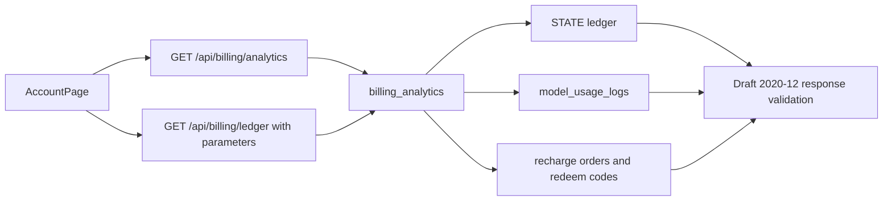
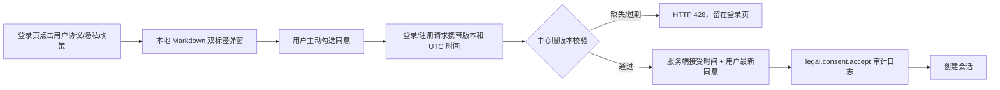
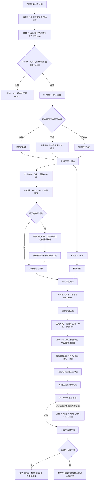
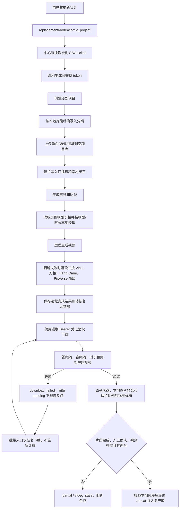

# 架构说明

## 范围

本文描述 Mac 本地客户端中“内容采集 -> 一键分解视频 -> 同款替换生成”的可靠性链路。涉及三个运行单元：

- 原生客户端：`backend/matrix_native_client.py`，负责页面、关键帧、OCR、音频分片、转写重试、临时报告、同款替换分段生成、合成和资产库登记。
- 本地执行引擎：`backend/api_server.py`，默认监听 `127.0.0.1:9081`，负责抖音鉴权下载和本地素材库。
- 中心服：`backend/central_server.py`，默认监听 `127.0.0.1:9080`，负责用户会话、节点调度、中心素材镜像和 LK888 反代。

## 账户中心账单数据流

- `AccountPage` 分别维护 analytics 与 ledger 的日期、筛选、分页和请求序列，迟到响应不能覆盖较新的成功结果。
- 中心服先校验查询参数，再按账户读取 `STATE` 流水、主库 `model_usage_logs` 和充值来源，交给 `billing_analytics` 归一化、去重、汇总并校验成功响应。
- 正常账户查询最多覆盖 366 天；主库读取上限为 50,001 行，达到该上限即拒绝生成可能不完整的统计结果。
- 运行时 JSON Schema 使用 `jsonschema==4.23.0`。本地与部署 requirements 保持同一精确版本锁定。
- 该链路复用中心服现有会话、数据源和配置所有权，不新增密钥、连接串、端口、数据库表或 Docker 服务。健康检查仍为 `/api/health`。

## 登录与法律同意流

- 法律正文位于 `backend/legal/`，和客户端一起打包，不依赖 HTTP 或自签名 HTTPS 页面。
- 客户端保存已同意版本用于自动登录门禁；中心服以自身时间保存用户最新同意，并复用现有审计日志镜像。
- 协议版本由 `LEGAL_TERMS_VERSION` / `LEGAL_PRIVACY_VERSION` 管理。任一版本提升都会阻断旧自动登录，要求重新确认。

## 三角色与企业数据边界

本地客户端登录后从中心服读取 `appRole/productRole/roleScope`，左侧菜单和账户中心资金入口按角色显示；中心服仍是最终权限边界，客户端 UI 隐藏只作为体验优化。

- 企业是数据归属范围，不是平台权限。两个账号同属一个企业时，体现为它们拥有同一个 `orgId` 下的 membership。
- `platform_admin` 是平台管理员，只能由 root token、`user-owner` 或显式 `isPlatformAdmin` 产生，可管理所有企业、所有用户和资金入口。
- `enterprise_admin` 是企业家，由企业内 `owner/admin` 映射而来，只能看本企业成员、账号、素材、知识库、任务、风控、获客和私信销售数据。
- `normal_user` 是普通用户，由企业内 `member` 映射而来；即使与别人同属一个企业，也只看 `createdBy/createdByUserId/ownerUserId/userId` 指向自己的业务数据。
- 充值、兑换码、生成兑换码和用户加款全部属于平台资金入口，只允许 `platform_admin`。

## 抖音多账号授权

本地执行引擎维护抖音账号注册表 `douyin_accounts.json`，并将每个新增账号的浏览器 profile 与 Cookie 缓存放在 `douyin_accounts/<account-id>/` 下。`fresh=true` 登录不再挪走或删除旧 `dy_profile`，而是打开临时 profile，登录成功后按 Cookie 派生稳定 `douyin-<hash>` 账号 ID，再迁入该账号目录。

账号矩阵读取 `/api/accounts` 时会看到多个抖音账号。发布任务继续使用既有 `accountId` 字段；执行前本地引擎切换到对应账号的 `profileDir` 和 `auth_cookie.json`，结束后恢复调用前环境。旧队列和未显式选择账号的任务仍兼容 `douyin-self`。

## 数据流

## 关键边界

### 下载边界

- 视频请求使用当前抖音登录 Cookie、浏览器 User-Agent、`Referer`、`Accept` 和 `Range`。
- 响应先写入每任务独立的 `.part`。只有状态码、Content-Type、错误页特征、媒体元数据和 ffmpeg 从头到尾全量解码都通过后，才原子替换正式文件。
- 403 只刷新一次签名直链，第二次失败直接返回明确错误，不入库。
- LK888 反代只允许 HTTPS，使用系统 CA 校验证书和主机名；不跟随 3xx，且最终 URL 必须与初始 URL 同源。

### 素材边界

- 本地库和中心库都在入库前重新校验媒体：视频执行 ffmpeg 全量解码，图片执行 Pillow `verify + load`，不只信任扩展名。
- 同源历史文件损坏时，旧文件进入 7 天隔离目录，新文件替换原记录；`id`、`createdAt` 和引用关系不变。
- 无效新文件不创建素材记录。
- 隔离复制、隔离元数据、文件替换和素材状态持久化按事务顺序执行；任一步失败都恢复旧文件和旧记录，不留半替换状态。

### 分析边界

- 页面预检失败后不执行抽帧、OCR、视觉模型或转写。
- OCR 优先使用 Tesseract；不可用时自动回退 RapidOCR。
- 转写顺序执行，默认每片 60 秒，最多 600 秒。失败区间可单独重试，不重复下载、抽帧或 OCR。
- 页面只保留源视频路径、内存分析状态和报告文本；关键帧与音频分片在任务 `finally` 中删除，崩溃遗留目录默认 3600 秒后由下次启动清理。
- 页面忙碌锁保证同一页面一次只运行一个分解或重试任务。

### 替换生成边界

- `hybrid_v2` 不再设置单视频总时长硬上限、默认约 8 秒分段、并发固定为 1。方案阶段允许人工修正口播/非口播类型和口播稿。
- 新主角模式在方案阶段从六张源视频关键帧调用 LK888 Vision，保存 `principalActor`（最佳帧、归一化 bbox、置信度、描述和本地预览）；置信度不足时必须人工确认主角候选后才能下单。新任务接受 1-3 张人物参考图，至少一张全身图由页面确认并写入 `personReferenceFullBodyConfirmed`。
- `principalReplacementMode=source_video_edit` 时，非口播片段默认调用 `VIDEO_REPLACE_PRINCIPAL_MODEL`（默认 `happyhorse-video-edit`）；用户也可在同款替换页选择任务级 LK888 模型，任务 JSON 的 `model` 会覆盖默认值。“SD 2.0 全能参考”使用真实模型标识 `kwvideo-v2-quannengcankao`。请求同时传 `video`/`images`、兼容视频别名和 `audio_setting=origin`；上游失败标记 `principal_video_edit_failed` 并记录实际模型。设置 `VIDEO_REPLACE_PRINCIPAL_REPLACEMENT=0` 回滚新任务到旧候选链。
- 当前同款替换新任务不再向用户开放“产品镜头锚定”“原片动作控制”“人物一致性”入口。新任务固定走主角整身远程替换主链路，写入 `identityMode=standard`、`enableFaceFusion=false`、`actionControlEnabled=false`、`productAnchorEnabled=false`；旧任务字段和 helper 保留为历史兼容。
- 口播片段先以产品、授权人物和场景生成稳定关键帧，再复用 `TTS -> kling-avatar-image2video(mode=std)` 生成真实音频驱动口型。
- 参考图在下单前区分本地文件、当前中心素材 URL 和公网 URL。中心服配置 `PUBLIC_MEDIA_BASE_URL` 后，为素材返回带 `orgId/expires/token` 的短期 HTTPS `publicUrls`；客户端优先将这些 URL 传给 LK888。本地/中心图片只在内存中转 data URL；Base64 不写任务 JSON 和日志。可灵数字人优先使用公网头像/关键帧 URL；没有公网 URL 时才用 JSON `params.image=data:image/...;base64,...` 兜底。
- 公网 URL 检查拒绝 localhost、私网 IP、link-local 和保留地址。非口播视频编辑未取得公网素材契约时在远程生成前停止，不把 `127.0.0.1` 传给 LK888。
- 回滚模式的非口播片段先裁出原片段并上传公网 URL，继续使用参考图视频候选链 `viduq3-turbo-cankaosheng -> wan2.7-cankaosheng -> viduq3-cankaosheng -> viduq2-cankaosheng -> happyhorse-r2v -> happyhorse-1.1-r2v`。主角模式不执行事后 FaceFusion，避免换掉全身服装/体型；只有旧任务的高一致模式才保留 FaceFusion 分支。
- 同款替换新增三层漂移防护：生成前从分解报告提取源视频行业、角色、产品和结构，参考图预检只允许人物图贡献身份特征；下单提示词显式锁定源视频主题和营销结构，人物参考图中的行业、商品、背景和道具不能覆盖原片；生成后视觉 QC 检查 `topicMatch`、`roleMatch`、`structureMatch` 和 `severeDrift`。汽车销售视频漂移成美妆、食品带货或无关生活方式内容会先自动重试一次，第二次仍失败则阻断合成。
- 严重漂移阻断适用于当前标准主链路和旧任务模式。普通 `face_mismatch`、`product_mismatch`、`scene_mismatch` 仍默认进入人工审核提醒，除非显式设置 `VIDEO_REPLACE_STRICT_VISUAL_QC=1`。
- 每段必须通过媒体真实性和非静音音频。远程视觉 QC 检查人物、产品形状/颜色、Logo/主要包装文字和场景，并用原片源片段判断 `sourceProductVisible`；原片本段没有产品时产品/Logo 检查跳过。不一致默认作为人工审核提醒，只有设置 `VIDEO_REPLACE_STRICT_VISUAL_QC=1` 时才阻止合成。
- 自动 QC 后进入 `awaiting_review`，展示首、中、尾帧并要求人工试听确认。人工确认前不合成、不入资产库。
- 最终 ffmpeg 统一为 H.264、720x1280、30fps、AAC 48kHz 双声道，按约 -16 LUFS、-1 dBTP 处理；合成后再次验证音轨存在且非静音。
- 中心人脸副本在完成或取消后删除；本地任务目录保留 24 小时后清理。成片先复制到稳定资产目录，因此临时目录清理不会删除资产库文件。

### 同款替换漫剧项目模式

- 新同款替换任务默认 `replacementMode="comic_project"`；旧 JSON 没有该字段或字段不是 `comic_project` 时继续按 legacy 链路打开。
- 同款替换项目以 `source_mode="matrix_video_replacement"` 创建，直接写入精确分镜，不再调用分析器二次扩写；项目库初始为空。该行为只作用于同款替换，普通漫剧项目继续原有分析流程。
- 人物参考图写入漫剧项目“角色”，场景图写入“场景”，产品图写入“道具”；角色同时携带用户在本地客户端选择的 AI 音色。
- 片段表在漫剧模式下固定为“序号、口播稿、首帧图、尾帧图、视频、操作”。远程缩略图在后台加载，文本编辑器受表格单元格约束，不再悬浮或撑破表格。
- 每段生成都会持久化 `comicStoryboardId`、`startFrameTaskId/startFrameUrl/startFramePath`、`endFrameTaskId/endFrameUrl/endFramePath`、`comicVideoTaskId/comicVideoResult/videoUrl/videoPath` 和恢复状态。`flowchartTaskId/flowchartUrl` 仅作为旧 JSON 的首帧兼容别名。
- 远程生成成功不等于片段可用。客户端先保存远程任务结果，再由 `ComicProjectAdapter` 对同源受保护媒体携带当前 Bearer Token 下载；遇到 401 仅清空凭证、刷新一次并重试一次。外部 CDN 继续无鉴权下载，避免向第三方主机泄露漫剧凭证。
- 视频和图片先写每次请求独立的临时文件。视频必须通过视频流、音频流、时长和完整解码校验，图片必须能被本地图像解码器读取；成功后原子替换目标文件。片段只有进入 `done` 后才可播放和参与合成，下载或校验失败进入 `download_failed`，不误报为远程模型生成失败。
- 首帧和尾帧分别独立重生成，只更新被选中的任务、远程地址和本地缓存。成功后旧视频元数据进入 `retryHistory`，当前 `videoPath` 失效，状态转为 `video_stale`；旧文件保留用于追溯，但不能参与最终合成。
- “重新生成视频”始终是视频专用操作：只使用当前最新首帧、尾帧、口播稿和声音模式提交视频，不隐式重生成图片。批量重试跳过缺首帧或尾帧的片段并提示先补帧，同时继续处理双帧完整的其他失败片段。
- 远程任务已完成但本地下载失败时，片段保存 `pendingComicVideoRecovery`。批量重试对这类片段只执行鉴权下载和媒体校验，不更新分镜、不提交新模型任务、不再次扣费；失败后保留远程任务 ID、脱敏地址摘要、下载次数和最新 `errorId`，供下次继续恢复。
- 表格只读取已校验的本地媒体：点击首帧或尾帧打开客户端内本地图片预览；点击视频打开独立模态预览，按源媒体宽高比使用 `contain` 展示，窗口不超过可用屏幕 82%。预览父对象是稳定页面窗口，表格刷新和播放结束都不会自动关闭，只有用户手动关闭时释放播放器。公网媒体地址不作为单元格文本或提示展示。
- 本地客户端在每次初次视频生成或单段视频重生成提交前读取漫剧 `/api/model-prices`，按模型计费方式与分镜时长生成 `comicVideoBilling` 快照并向中心账户扣费。提交或远程等待失败按唯一引用幂等退款；远程任务已成功而本地下载失败时不退款，`pendingComicVideoRecovery` 仅恢复下载且不再次扣费。扣费和退款日志只保存项目、片段、模型、金额、时长、计费方式和引用摘要。
- Seedance 在精确真人隐私拒绝或 R2V 明确返回音频时长超过模型上限时启动降级链；之后任一已受理模型明确失败才继续下一个模型。轮询超时、502 或限流先查询原远程任务，不创建重复任务。每次失败扣费单独退款，成功任务保留 `fallbackCandidates/fallbackIndex/fallbackHistory`。
- 漫剧项目模式不调用“已有视频口型同步”模型。备用首尾帧模型只接收首尾两张图并移除不支持的音频字段，避免为口型重生成整段而破坏人物、产品和场景。
- 声音模式按请求显式隔离：`auto` 保留本次 provider 生成视频自带声音，不准备 TTS，也不在备用模型完成后重混，任务记录 `audioSource=provider_generated`、`audioMixStatus=not_requested`；`tts` 根据当前口播稿和所选音色准备分镜 TTS，备用模型结果也强制重混为 `storyboard_tts`。历史 `source/origin/original/source_audio` 在客户端归一化为 `auto`；未携带 `audio_mode` 的漫剧网站请求保持 `legacy` TTS 行为。
- 远程直提和批量分镜视频属于同一重复任务识别族，但重复匹配同时比较 `auto/tts/legacy` 声音语义：同一语义可复用既有活动任务，语义不同必须隔离，防止自动原声请求误复用 TTS 任务或反向污染。与分镜视频无关的其他批量任务不加入该重复识别族。
- 最终合成门禁按声音模式区分：漫剧 `audioMode=auto` 要求每个片段 `status=done`、已人工确认、本地视频可解码且真实存在音轨，不再读取历史 `audioStatus/qcStatus` 作为硬阻断；其他模式继续要求音频和质量检查通过。`video_stale`、`download_failed`、未确认、缺失/损坏视频或无音轨都会在 concat 前给出逐段原因，成片合成后再做音频检查并登记资产库。
- 上传完整配音还没有接入漫剧分镜的稳定片段音频接口，因此漫剧项目模式继续在生成前阻断该选项。
- 回滚使用 `VIDEO_REPLACE_DEFAULT_MODE=legacy`，不需要数据库迁移。旧链路代码保留是为了历史任务查看和紧急回退，不是新任务默认路径。

## 可观测、可回滚、可追溯

- 新链路异常写单行 JSON，包含 `event`、`errorId`、上下文和堆栈。
- 日志统一脱敏 Cookie、Authorization、API Key、Bearer Token、Base64 和签名 URL 查询值。
- 漫剧生成、凭证刷新、下载、媒体校验和播放器异常只记录任务/项目/分镜/片段标识、媒体类型、HTTP 状态、错误码、主机和文件名；不记录 Token、完整请求头、完整媒体 URL 或敏感查询参数。
- 首次变更前快照位于 `backups/video-breakdown-reliability-20260711_190142/`，各阶段包含 SHA256 清单。
- 无数据库表变更；回滚只需要恢复代码文件和依赖清单，不执行数据降级脚本。
- 新素材入库和历史素材修复都保存旧库快照；持久化、隔离或替换失败时就地回滚。
- 同款替换任务状态原子保存到 `video_replacements/<job-id>/replacement_job.json`，记录片段阶段、音频/QC/审核状态和 `errorId`。`VIDEO_REPLACE_PIPELINE` 可回退到稳定入口，不需要数据迁移。
- 法律同意保存在中心状态 `legalConsents`和现有 `auditLogs`，未新增数据库表；回滚代码时可保留历史审计记录。

## 非功能指标

- 并发：单客户端分解页并发 1。
- 时长上限：单视频最多转写前 600 秒。
- 分片：默认 60 秒，顺序请求。
- 远程超时：单分片默认 180 秒，失败后最多重试 2 次。
- 本地探测：单次 ffmpeg 元数据探测超时 20 秒；全量解码预算按视频时长动态计算，范围 60-600 秒。
- 容错：转写失败时保留关键帧、OCR 和视觉分析；单帧 OCR 失败不阻断其他帧。
- 替换生成：单客户端并发 1；整片不设固定总时长上限；片段默认 8 秒且单段请求时长钳制在 1-15 秒；新任务不启用动作帧锚定、产品锚定帧或本地 FaceFusion；人工确认前不入资产库，失败片段可单独重试。
- 关键帧参考图单图默认上限 20 MiB；同步图片中心代理超时 480 秒，客户端超时 540 秒。
## Windows 本地存储边界

Windows 源码部署的本地客户端数据根目录由 `backend/runtime_paths.py` 统一解析。优先级为：`MATRIX_AGENT_DATA_DIR` / `DY_DATA_DIR` 显式配置、`MATRIX_AGENT_USE_APPDATA=1` 回滚旧 AppData 目录、默认 `backend/datas`。中心服素材库仍由 `CENTRAL_DATA_DIR` 控制，默认 `backend/central_data`。

该边界保证视频下载、同款替换任务、浏览器 profile、日志、工作流产物和授权 token 不再默认落到 C 盘。首次启动只会从旧 `%APPDATA%\MatrixShipAgent\data` 向新目录复制缺失文件，不删除旧数据，便于回滚和审计。

## 小红书图文同款链路

`图文同款` 是本地执行引擎内的草稿生成链路，不新增中心数据库表。入口来自原生客户端“内容生产 -> 图文同款”和素材发布图文素材卡。小红书下载会把用户发布的正文图片、原始标题、正文、标签和本地 `savePath` 一起入库；后端按 `template -> preview -> save-draft` 落本地 JSON 任务，任务文件位于当前账号数据目录的 `xhs_note_replacements/<jobId>/replacement_job.json`。

数据流：采集素材或 `sourceNote` 生成模板；用户确认标题、所在地、目标客户和可编辑卖点；替换图按原笔记图片数量显示为一张图一个框，用户可多选本地图片按顺序填充，缺图必须手动选择替换图片；预览阶段生成 3 组标题、正文、标签方案并记录用户选择；保存阶段要求所有槽位都有可读取图片，之后生成 `image_note` 草稿并写入素材库。发布链路在本地和中心服预检处都调用同一个 blocker，避免误把多图图文走成视频或单图发布。

可观测性：下载入库失败通过 `download_library_import_failed` 输出结构化日志；保存异常通过 `xhs_note_save_failed` 输出 `errorId`；空图保存会直接返回 `xhs_note_replacement_missing_images`。任务和素材都携带 `replacementJobId`、`sourceTemplateId` 与 `importedFromXhsNoteReplacement`，便于回溯来源。回滚时关闭 `XHS_NOTE_REPLACEMENT_ENABLED=0` 即可让接口快速失效，代码级回滚只需恢复本次涉及文件。
