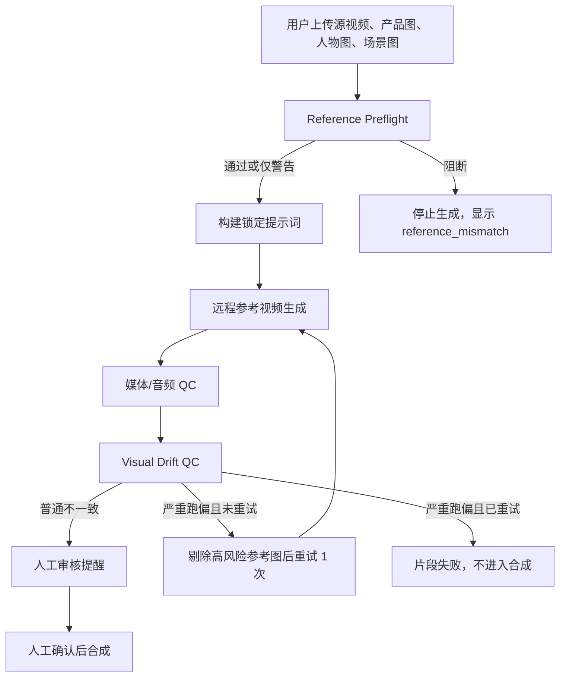

# Video Replacement Drift Guard Design

## 背景

同款替换当前已拆成 `fast`、`standard`、`high` 三种人物一致性模式，并且默认 `standard` 不再执行本地 FaceFusion。真实任务 `38aaff3891c748d7b97d06ab41084cca` 暴露了另一个项目级问题：生成链路没有阻止严重主题跑偏。

该任务的源视频是丰田门店男销售讲车，替换后视频在中段变成美妆主播和化妆品近景。任务 JSON 显示：

- `identityMode=standard`
- `enableFaceFusion=false`
- 所有片段 `qcStatus=passed`
- 上传的人物参考图文件名为美妆主播素材

这说明问题不是 FaceFusion 超时，而是远程参考图生成被人物或产品参考污染，视觉 QC 又没有识别“汽车销售视频变成美妆带货视频”这种严重跑偏。

## 用户已确认的产品规则

1. 上传人物图只用于锁定人物脸、发型、外貌和必要服装特征，不继承人物图里的行业、商品、直播类型或背景。
2. 原视频的行业、场景、产品类别、人物角色、镜头结构和营销脚本结构优先级高于上传参考图的上下文。
3. 生成后发现严重跑偏时，系统自动重试 1 次；重试时剔除或弱化高风险参考图，并强化原视频锁定提示词。
4. 第二次仍严重跑偏时，片段标记失败，不进入最终合成。
5. 严重跑偏强门禁对 `fast`、`standard`、`high` 三种模式都生效。

## PRD

### 目标

- 在生成前识别明显不匹配的参考图，降低远程生成被带偏的概率。
- 在生成提示词中明确锁定源视频行业、场景、人物角色和镜头结构。
- 在生成后区分普通视觉不一致和严重主题跑偏，严重跑偏必须阻断。
- 自动重试一次可修复的跑偏片段，减少人工反复操作。
- 在任务 JSON、结构化日志、页面状态和文档中留下完整追踪信息。
- 保持可配置回滚，不影响已有任务读取。

### 非目标

- 不更换远程视频生成模型供应商。
- 不新增数据库表。
- 不承诺远程模型百分百复制原视频动作或人物身份。
- 不在第一版引入本地大模型、向量库或复杂 embedding 检索。
- 不把普通脸不像、产品轻微不一致全部升级为硬失败。

### 用户体验

生成前：

- 如果参考图与源视频明显冲突，页面显示阻断或强警告。
- 阻断示例：汽车销售源视频中上传明显美妆、食品、服装带货产品图作为产品参考。
- 强警告示例：人物图是美妆主播，但用户确认只借用脸，不继承场景。系统允许继续，但任务记录风险。

生成中：

- 状态文本显示是否进入“跑偏重试”。
- 重试时保留原错误编号和重试原因。

生成后：

- 普通视觉不一致继续进入人工审核。
- 严重跑偏显示为“生成内容偏离原视频主题，已阻断合成”。
- 失败片段可单独重试。

### 非功能性需求

- QPS：单客户端同款替换仍保持并发 1；新增 QC 不提高远程视频生成并发。
- 延迟：每个片段新增预检/QC 总耗时目标小于 20 秒；远程视觉服务异常时 30 秒内降级为人工审核或失败策略。
- 显存：第一版不引入本地 GPU 模型，新增能力不增加本机显存占用。
- 成本：严重跑偏自动重试最多 1 次，避免无限重试造成远程计费失控。
- 可观测：每次预检、QC、重试和阻断都写入结构化日志与 `replacement_job.json`。
- 可回滚：通过环境变量关闭预检、强门禁或自动重试，保留旧宽松 QC 行为。

## 技术选型

### 选型对比矩阵

| 方案 | 描述 | 优点 | 缺点 | 结论 |
| --- | --- | --- | --- | --- |
| 最小增强 | 只改提示词和现有 QC 文案 | 开发最快，风险低 | 生成前仍会被错误参考图带偏，QC 仍可能漏判 | 不采用作为主方案 |
| 三层防护 | 预检 + 提示词锁定 + 严重跑偏 QC/重试 | 覆盖本次真实问题，成本可控，可灰度 | 需要新增数据字段、测试和文档 | 采用 |
| 重型识别 | 本地/远程 embedding、行业分类器、人脸相似度、产品检测 | 上限最高，可量化更细 | 开发周期长，依赖和误判成本高 | 二期再评估 |

### 第一版实现技术

- 使用现有 `lk888_vision` 做多模态预检和视觉 QC，不新增模型供应商。
- 使用确定性 Python helper 解析 QC JSON，生成错误码、严重级别和重试策略。
- 使用现有本地 JSON 任务文件保存状态，不新增数据库迁移。
- 使用环境变量做灰度和回滚开关。

## 架构设计

### 三层防护



### 生成前：Reference Preflight

新增预检 helper：

```text
_run_replacement_reference_preflight(job) -> dict
```

输入：

- 源视频分解报告中的 `visual`、`frameNotes`、`ocr.text`、`transcript.text`
- 产品参考图
- 人物参考图
- 场景参考图和场景描述

输出示例：

```json
{
  "ok": true,
  "severity": "warning",
  "sourceCategory": "汽车销售",
  "sourceRole": "门店销售顾问",
  "sourceProductCategory": "汽车",
  "referenceRisks": [
    {
      "type": "face_context_mismatch",
      "path": "/Users/mac/Downloads/美妆主播带货图生成需求-4.png",
      "reason": "人物图包含美妆带货上下文，只能作为脸部参考"
    }
  ],
  "blocked": false,
  "reason": "人物参考上下文与源视频行业不同，但不作为产品或场景参考"
}
```

阻断规则：

- 产品图与源视频产品类别明显冲突，默认阻断。
- 场景图与用户场景描述冲突，默认强警告；如果配置 `VIDEO_REPLACE_PREFLIGHT_BLOCK_SCENE=1`，则阻断。
- 人物图上下文与源视频行业冲突，不默认阻断，但记录为风险，并在重试时可弱化该图影响。
- 纯产品模式不检查人物图。

### 生成中：Source Lock Prompt

所有视频生成提示词增加源视频锁定区：

```text
Source lock:
- Preserve original video category: <sourceCategory>.
- Preserve original subject role: <sourceRole>.
- Preserve original product category: <sourceProductCategory>.
- Preserve original scene type and marketing structure.
- Person references are identity-only references. Do not copy their product, industry, room, livestream setup, cosmetics, props, captions, or background.
- If references conflict, source video category and uploaded product category win.
```

中文业务含义：

- 人物图只锁脸，不带行业。
- 产品图只锁产品，不带人物和场景。
- 场景图只锁背景，不覆盖源视频行业和脚本结构。
- 源视频结构优先。

### 生成后：Visual Drift QC

在现有 `_run_replacement_visual_qc()` 基础上扩展 JSON Schema：

```json
{
  "sourceProductVisible": true,
  "faceMatch": true,
  "productMatch": true,
  "logoTextReadable": true,
  "sceneMatch": true,
  "topicMatch": true,
  "roleMatch": true,
  "structureMatch": true,
  "severeDrift": false,
  "reason": "简短原因"
}
```

新增判定：

- `topicMatch=false`：行业/商品主题明显变了，例如汽车讲解变美妆带货。
- `roleMatch=false`：人物角色明显变了，例如门店销售变美妆主播。
- `structureMatch=false`：镜头结构明显变了，例如原视频讲车走位变成产品手部特写。
- `severeDrift=true`：任一严重主题跑偏，需要强门禁。

错误码：

- `visual_drift_blocked`：严重跑偏，阻断。
- `topic_mismatch`：主题不一致。
- `role_mismatch`：人物角色不一致。
- `structure_mismatch`：视频结构不一致。
- `reference_mismatch`：生成前参考图预检失败。
- `visual_drift_retry_exhausted`：自动重试后仍跑偏。

严重级别：

- `blocking`：严重跑偏、媒体损坏、音频缺失。
- `review_warning`：普通人脸、产品、场景不一致。
- `deferred`：视觉服务异常，需人工审核。

### 自动重试策略

触发条件：

- QC 返回 `visual_drift_blocked`
- 当前片段 `driftRetryCount < 1`
- 任务未取消

重试行为：

- `driftRetryCount += 1`
- 记录 `retryReason=visual_drift_blocked`
- 对高风险人物参考图增加“identity only”说明。
- 如果预检标出某张参考图为高风险产品/场景图，则从重试参考列表中剔除。
- 强化提示词中的 source lock。

重试失败：

- 片段 `status=failed`
- `qcStatus=failed`
- `blockedReason=visual_drift_retry_exhausted`
- 不进入最终合成。

## 数据模型

新增 job 字段：

```json
{
  "referencePreflight": {
    "status": "passed|warning|blocked|deferred",
    "sourceCategory": "",
    "sourceRole": "",
    "sourceProductCategory": "",
    "referenceRisks": [],
    "reason": ""
  },
  "driftGuardConfig": {
    "enabled": true,
    "preflightEnabled": true,
    "blockSevereDrift": true,
    "autoRetry": true,
    "maxRetries": 1
  }
}
```

新增 segment 字段：

```json
{
  "visualDriftQc": {
    "topicMatch": true,
    "roleMatch": true,
    "structureMatch": true,
    "severeDrift": false,
    "reason": ""
  },
  "driftRetryCount": 0,
  "retryReason": "",
  "blockedReason": ""
}
```

兼容性：

- 旧任务没有这些字段时按未启用跑偏防护处理。
- 新任务写入字段，但不改变已有 `identityMode`、`enableFaceFusion`、`qcWarnings` 的读取兼容。

## 配置与回滚

新增环境变量：

| 变量 | 默认值 | 含义 |
| --- | --- | --- |
| `VIDEO_REPLACE_DRIFT_GUARD` | `1` | 总开关 |
| `VIDEO_REPLACE_REFERENCE_PREFLIGHT` | `1` | 生成前参考图预检 |
| `VIDEO_REPLACE_BLOCK_SEVERE_DRIFT` | `1` | 严重跑偏强门禁 |
| `VIDEO_REPLACE_DRIFT_AUTO_RETRY` | `1` | 严重跑偏自动重试 |
| `VIDEO_REPLACE_DRIFT_MAX_RETRIES` | `1` | 单片段跑偏重试次数 |
| `VIDEO_REPLACE_PREFLIGHT_BLOCK_SCENE` | `0` | 场景图冲突是否阻断 |

回滚方式：

```bash
VIDEO_REPLACE_DRIFT_GUARD=0
```

或分层回滚：

```bash
VIDEO_REPLACE_REFERENCE_PREFLIGHT=0
VIDEO_REPLACE_BLOCK_SEVERE_DRIFT=0
VIDEO_REPLACE_DRIFT_AUTO_RETRY=0
```

不涉及数据库迁移，`migration.sql` 不需要新增实际 SQL。

## 错误处理与结构化日志

所有异常和阻断都通过现有 `json_log()` 输出，必须脱敏本地路径和公网签名 URL。

新增日志事件：

- `video_replace_reference_preflight_failed`
- `video_replace_reference_preflight_blocked`
- `video_replace_visual_drift_blocked`
- `video_replace_visual_drift_retry`
- `video_replace_visual_drift_retry_exhausted`

日志上下文：

- `job_id`
- `segment_index`
- `identity_mode`
- `source_category`
- `source_role`
- `source_product_category`
- `qc_code`
- `retry_count`
- `errorId`

## 测试策略

新增或更新 `tests/test_video_replacement_v2.py`：

- 人物图上下文与源视频行业冲突时，预检返回 warning 而不是阻断。
- 产品图与源视频产品类别冲突时，预检返回 `reference_mismatch` 阻断。
- 生成提示词包含 source lock，并明确人物图是 identity-only。
- `topicMatch=false` 或 `severeDrift=true` 时，三种身份模式都阻断。
- 普通 `face_mismatch`、`product_mismatch` 仍按现有策略进入人工审核。
- 严重跑偏第一次触发自动重试，第二次触发 `visual_drift_retry_exhausted`。
- `VIDEO_REPLACE_DRIFT_GUARD=0` 时恢复旧行为。
- 任务 JSON 写入 `referencePreflight`、`visualDriftQc`、`driftRetryCount`、`blockedReason`。

建议验证命令：

```bash
.venv/bin/python -m unittest tests.test_video_replacement_v2 -v
.venv/bin/python -m unittest tests.test_video_replacement -v
.venv/bin/python -m py_compile backend/matrix_native_client.py
```

## 文档更新范围

实施时同步更新：

- `docs/ARCHITECTURE.md`
- `docs/API_REFERENCE.md`
- `docs/DEPLOYMENT.md`
- `docs/TROUBLESHOOTING.md`
- `docs/IMPLEMENTATION.md`
- `CHANGELOG.md`

`docs/IMPLEMENTATION.md` 必须在代码改动后重算所有涉及 `backend/matrix_native_client.py#L...` 和 `tests/test_video_replacement_v2.py#L...` 的行号。

## 验收标准

- 汽车销售源视频不能生成成美妆、食品、服装等无关行业视频并进入合成。
- 人物图可来自不同行业，但只能作为身份参考，不得污染场景和商品。
- 严重跑偏片段最多自动重试 1 次。
- 自动重试失败后，片段失败且最终合成不可用。
- 快速、标准、高一致三种模式都执行严重跑偏门禁。
- 关闭 `VIDEO_REPLACE_DRIFT_GUARD` 后可回到旧行为。

## 后续二期

- 引入可量化的本地或远程 embedding 相似度。
- 增加行业标签库和产品类目白名单。
- 增加人物身份相似度分数。
- 增加产品/logo 检测分数。
- 把严重跑偏样本沉淀为回归测试素材集。
