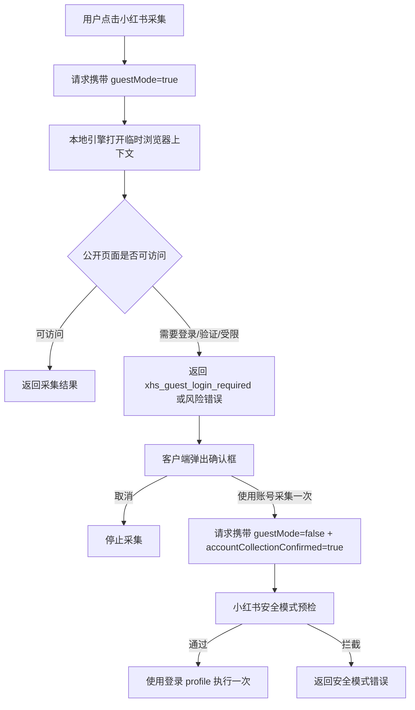

# 小红书游客采集与账号采集确认设计

## 背景

当前小红书搜索、下载笔记、读取评论和获客中心寻找线索会在检测到 `xhs_profile` 已登录时复用登录浏览器资料。这会让“采集浏览行为”和“账号互动/发布行为”混在同一个账号风险池里。

目标是降低账号风险：公开可访问内容默认用游客方式采集；只有平台要求登录、且用户明确确认时，才临时使用登录账号采集一次。评论、私信、发布仍然必须使用登录账号，并继续受小红书安全模式约束。

## PRD

### 用户目标

- 用户可以继续采集小红书公开笔记、图片、评论和意向线索。
- 默认采集不消耗登录账号行为风险。
- 如果小红书要求登录，用户能明确选择是否“使用账号采集一次”。
- 系统不能在用户不知情的情况下自动切换到登录账号采集。

### 功能需求

1. 内容采集页小红书搜索、下载、图文同款下载、看评论默认使用游客采集。
2. 获客中心小红书寻找线索默认使用游客采集。
3. 小红书游客采集遇到登录墙、验证码、IP 风险、安全验证或访问受限时，返回明确错误，不自动复用账号。
4. 界面收到上述错误后弹出确认框，说明“公开访问受限，本次采集需要登录账号”。
5. 用户点击“使用账号采集一次”后，当前这一次请求携带 `guestMode=false` 和 `accountCollectionConfirmed=true`。
6. 登录账号采集前必须走小红书安全模式预检，命中冷却、上限或暂停状态时不执行。
7. 登录账号采集只作用于当前一次搜索/下载/评论读取/寻找线索，完成后页面默认仍回到游客采集。
8. 发评论、私信、发布图文/视频不走游客模式，继续使用登录账号和既有安全模式。

### 非功能性需求

- 默认游客采集单次最多搜索 30 条，获客中心单次最多读取 20 篇笔记、每篇最多 80 条评论，沿用现有限制。
- 单次浏览器任务超时沿用现有接口：搜索/评论约 200 秒，下载约 600 秒，获客约 300 秒。
- 游客采集不得读取 `xhs_profile`、`xhs_auth_state.json` 或登录 Cookie。
- 账号采集确认弹窗必须是单次确认，不保存为长期默认。
- 错误日志必须结构化、脱敏，不记录完整 Cookie、Token、完整正文或完整搜索 URL 查询参数。

## 选型对比

| 方案 | 行为 | 优点 | 风险 | 结论 |
| --- | --- | --- | --- | --- |
| A 默认游客，失败后人工确认账号采集一次 | 默认不用账号；登录受限时用户确认一次 | 风险边界清楚，用户可理解，可追溯 | 多一步确认，采集成功率低于自动切换 | 采用 |
| B 默认游客，失败后自动切账号重试 | 系统自动借用账号采集 | 成功率最高 | 用户无感消耗账号风险，容易误伤账号 | 不采用 |
| C 页面提供长期游客/账号模式开关 | 用户可自由切换 | 灵活 | 用户容易长期停在账号采集模式，风险不可控 | 暂不采用 |

## 技术设计

### 数据流



### 后端接口行为

- `/api/xhs/search`
- `/api/xhs/download`
- `/api/xhs/comments`
- `/api/finder/discover` 且 `platform=xhs`

上述接口新增可选字段：

```json
{
  "guestMode": true,
  "accountCollectionConfirmed": false
}
```

规则：

- `guestMode=true`：强制游客采集，不使用登录 profile。
- `guestMode=false` 且 `accountCollectionConfirmed=true`：允许使用登录账号采集一次，先走安全模式预检。
- 缺省值：小红书采集类接口默认 `guestMode=true`。
- 发评论、私信、发布接口不接受游客模式。

### 浏览器上下文

小红书搜索、下载、读取评论的底层函数增加参数：

- `guest_mode=True`

当 `guest_mode=True` 时：

- `_xhs_open_context(..., persistent=False)`
- 不调用 `xhs_profile_ready()` 决定持久化 profile。
- 不读取账号 Cookie。

当 `guest_mode=False` 时：

- 仍可使用 `xhs_profile_ready()` 和持久化 `xhs_profile`。
- 请求必须带 `accountCollectionConfirmed=true`。

### 客户端交互

内容采集页：

- 小红书搜索状态改为“游客采集中：不使用登录账号”。
- 小红书下载状态改为“游客下载中：不使用登录账号”。
- 图文同款下载状态改为“游客下载笔记图片中：不使用登录账号”。
- 看评论状态改为“游客读取评论中：不使用登录账号”。

获客中心：

- 小红书寻找线索状态改为“游客寻客中：不使用登录账号”。

登录受限弹窗：

标题：`公开访问受限`

正文：

```text
小红书公开访问受限，本次采集需要登录账号。
为降低账号风险，系统不会自动使用账号采集。
你可以选择“使用账号采集一次”，该操作会计入风控中心。
```

按钮：

- `使用账号采集一次`
- `取消`

### 错误码

- `xhs_guest_login_required`：游客模式遇到登录墙。
- `xhs_guest_access_limited`：游客模式公开访问受限，但不是明确登录墙。
- `xhs_safety_interval`：安全模式冷却拦截。
- `xhs_safety_publish_limit`：发布上限拦截。
- `xhs_safety_comment_limit`：评论上限拦截。
- `xhs_safety_paused`：账号风险暂停拦截。

### 可观测、可回滚、可追溯

- 游客采集被拦截时记录结构化日志 `xhs_guest_collection_blocked`，只记录动作、错误码、关键词长度、URL 指纹、账号是否被请求，不记录完整正文、Cookie 或 Token。
- 登录账号采集一次时记录 `xhs_account_collection_confirmed`，记录动作、账号 ID、来源页面和安全模式快照。
- 本功能不新增数据库表，不需要 `migration.sql`。
- 不新增公开 API 路径；仅扩展本地接口请求字段，OpenAPI 如已有本地接口契约则同步字段说明。
- 回滚优先设置 `XHS_GUEST_COLLECTION_DEFAULT=0` 并重启本地客户端和本地执行引擎，使小红书采集恢复旧的自动使用登录 profile 行为。

## 测试策略

1. 单元测试：游客模式下搜索/下载/评论读取不调用 `xhs_profile_ready()`。
2. 单元测试：小红书采集接口缺省 `guestMode=true`。
3. 单元测试：游客模式遇到登录墙返回 `xhs_guest_login_required`，不自动重试账号模式。
4. 单元测试：`guestMode=false` 但没有 `accountCollectionConfirmed=true` 时拒绝账号采集。
5. 单元测试：确认账号采集时仍走 `xhs_safety_preflight()`。
6. 客户端源码测试：内容采集页和获客中心请求携带 `guestMode=true`，确认重试请求携带 `accountCollectionConfirmed=true`。
7. 回归测试：发评论、私信、发布不受游客模式影响。

## 发布说明

上线后默认启用游客采集。真实账号风险不会归零，原因是发布、评论、私信仍然是账号行为；本功能只降低采集阶段对账号的影响。
