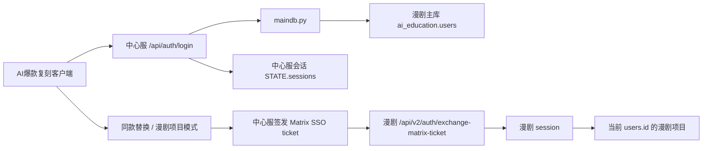

# Unified Comic Account SSO Design

## Goal

AI爆款复刻平台和漫剧平台共用同一套账号体系。漫剧 MySQL `ai_education.users` 作为唯一账号源；AI爆款复刻不再把普通用户登录降级到本地 JSON 用户；同款替换进入漫剧生成器时按当前登录用户映射，不再固定使用漫剧账号 `003`。

## Current State

- 中心服已有主库适配层 `backend/maindb.py`，读取 `ai_education.users` 的 `phone/email/username/password_hash/computing_power/is_admin/is_staff`。
- 中心服 `/api/auth/login` 当前能在 `MAINDB_ENABLED=1` 且主库健康时用漫剧用户校验密码。
- 中心服仍保留本地 JSON 用户和 `admin` / `user-owner` 运维登录兜底。
- 漫剧 SSO ticket 已存在，但同款替换默认通过 `MATRIX_COMIC_FIXED_USER_ID=44` / `MATRIX_COMIC_FIXED_USERNAME=003` 固定映射到同一个漫剧账号。
- 远程漫剧生成器 `tools/aicanvas_remote/server_current.py` 已具备 Matrix SSO ticket 交换能力。

## Product Requirements

### Functional Requirements

- 所有普通用户登录 AI爆款复刻时，必须使用漫剧主库 `ai_education.users` 的账号密码。
- 支持用手机号、邮箱、用户名或数字用户 ID 查找同一个漫剧用户。
- AI爆款复刻的注册、邀请入企、用户改密、管理员重置密码必须写回漫剧主库，不创建独立普通用户密码源。
- 用户从 AI爆款复刻进入漫剧工具或同款替换链路时，SSO ticket 的 `user_id/sub` 必须等于当前登录用户在 `ai_education.users.id` 中的 ID。
- 同款替换创建的漫剧项目、角色、场景、道具、分镜和视频任务必须归属当前用户，不再归属固定账号 `003`。
- 平台管理员身份从漫剧主库 `is_admin` 或 `is_staff` 映射为 AI爆款复刻 `platform_admin`。
- 保留 `USER_TOKEN` / `user-owner` 作为紧急运维入口，但不能作为普通用户账号体系的一部分。

### Non-Functional Requirements

- 登录接口 P95 延迟目标：主库健康时低于 800 ms。
- SSO ticket TTL：默认 60 秒，最大不超过 300 秒。
- 会话 TTL：沿用中心服 `CENTRAL_SESSION_TTL_SEC`，默认 7 天。
- 错误日志：认证失败、主库不可用、SSO 签发失败必须输出脱敏结构化日志，不记录密码、Token、Cookie、完整签名 URL 或数据库连接串。
- 可用性：主库启用但不可用时，普通用户登录必须返回明确 503，不允许静默降级到本地 JSON 用户。
- 并发：注册、邀请接受、改密和管理员重置密码必须避免重复建号、重复覆盖密码或产生跨账号会话。
- 安全：SSO secret 只存在服务器 `.env` / systemd / compose 环境变量中，不进入源码、日志、文档示例真实值或接口响应。

## Options

| Option | Description | Pros | Cons | Decision |
|---|---|---|---|---|
| A. 复制账号密码 | 把漫剧账号批量复制到 AI爆款复刻本地用户 | 实现最快 | 后续改密不同步，双密码源，安全风险高 | Reject |
| B. 共享主库 + 当前用户 SSO | AI爆款复刻所有普通账号直接读写漫剧主库，SSO 按当前用户 ID 签发 | 账号、密码、余额、权限天然一致；改动集中；可回滚 | 需要严格处理主库不可用和旧本地用户兼容 | Accept |
| C. 完整 OAuth/OIDC 认证中心 | 建独立统一认证服务，两个平台接入 | 长期标准化最好 | 当前上线成本高，需要新服务、回调、客户端改造 | Defer |

## Architecture

## Data Flow

### Login

1. 客户端提交 `identifier/password/legalConsent` 到 `/api/auth/login`。
2. 中心服在 `MAINDB_ENABLED=1` 时调用 `maindb.find_login_user(identifier)`。
3. 中心服用 `maindb.verify_password()` 校验 `users.password_hash`。
4. 成功后中心服创建自己的短期会话 token，返回 `user/appRole/productRole/organizations/balance`。
5. 主库不可用时返回 503 和脱敏错误码，不进入本地 JSON 普通用户兜底。

### Registration And Password Changes

1. 注册手机号写入或认领 `ai_education.users`。
2. 自助改密和管理员重置密码调用 `maindb.set_password()`。
3. 改密后撤销同用户其它中心服会话。
4. 审计日志只记录用户 ID、动作、状态、错误码和撤销会话数量。

### Comic SSO

1. 当前用户必须是主库用户。
2. 中心服签发 ticket 时使用当前 `user.id`，不读取 `MATRIX_COMIC_FIXED_USER_ID`。
3. 远程漫剧生成器校验 ticket 签名、issuer、audience、TTL 和 replay。
4. 漫剧生成器建立属于该 `users.id` 的会话。
5. 同款替换后续项目库和视频任务都在该用户上下文中创建。

## API Contract

- `/api/auth/login` 响应结构保持兼容，不新增明文凭证字段。
- `/api/auth/register` 保持现有字段，但生产模式写主库。
- `/api/auth/change-password` 保持现有字段，生产模式写主库。
- `/api/v1/aicanvas/sso-ticket` 保持现有 ticket 响应结构，但 `comicAccountMode` 从 `fixed` 改为 `mapped`。
- OpenAPI 需更新错误码：`maindb_required`、`maindb_unavailable`、`comic_sso_user_not_mapped`。

## Config

### Center Server

- `MAINDB_ENABLED=1`
- `MAINDB_HOST`
- `MAINDB_PORT`
- `MAINDB_USER`
- `MAINDB_PASS`
- `MAINDB_NAME=ai_education`
- `MATRIX_COMIC_SSO_ENABLED=1`
- `MATRIX_COMIC_SSO_SECRET=<server-only-secret>`
- `MATRIX_COMIC_SSO_ISSUER=matrix-central`
- `MATRIX_COMIC_SSO_AUDIENCE=aicanvas`
- `MATRIX_COMIC_SSO_TTL_SEC=60`

### Remote Comic Server

- `AICANVAS_MATRIX_SSO_ENABLED=1`
- `AICANVAS_MATRIX_SSO_SECRET=<same-server-only-secret>`
- `AICANVAS_MATRIX_SSO_ISSUER=matrix-central`
- `AICANVAS_MATRIX_SSO_AUDIENCE=aicanvas`

### Deprecated For Production

- `MATRIX_COMIC_FIXED_USER_ID`
- `MATRIX_COMIC_FIXED_USERNAME`
- `MATRIX_COMIC_FIXED_DISPLAY_NAME`

These variables may remain for emergency rollback only. Production default must be mapped-user SSO.

## Error Handling

- 主库关闭：生产配置返回 503 `maindb_required`。
- 主库连接失败：返回 503 `maindb_unavailable`。
- 用户不存在或密码错误：返回 401 `invalid_credentials`，不区分账号是否存在。
- 当前用户不是主库用户但请求漫剧 SSO：返回 403 `comic_sso_user_not_mapped`。
- SSO secret 缺失或长度不足：返回 503 `comic_sso_secret_missing`。
- 漫剧 ticket 被重放：远程返回 409 `matrix_sso_ticket_replayed`。

All logs must redact passwords, tokens, cookies, authorization headers, API keys and full signed URLs.

## Testing

### Phase 0 Smoke

- 用假主库连接或 mock `maindb` 跑通：登录请求 -> 主库用户验证 -> 中心服会话创建 -> SSO ticket 签发 -> 远程 ticket 校验。
- 记录失败点到 `docs/TROUBLESHOOTING.md`。

### Unit Tests

- 主库启用但不可用时，普通用户登录返回 503，不落本地 JSON。
- 主库用户登录成功后 `productRole` 正确映射。
- 手机号、邮箱、用户名、数字 ID 均可查找同一用户。
- SSO ticket 使用当前用户 ID，不使用固定 `003`。
- `MATRIX_COMIC_FIXED_USER_ID` 为空时 mapped 模式成功；固定变量存在但生产 mapped 模式打开时不生效。
- 改密调用主库并撤销其它会话。

### Deployment Smoke

- 公网 `/api/health` 正常。
- 使用漫剧已存在账号登录 AI爆款复刻。
- 登录后查询余额与漫剧 `users.computing_power` 一致。
- 点击进入漫剧工具后不需要再次输入账号密码。
- 新建同款替换任务后，漫剧项目归属当前用户 ID。

## Rollback

- 回滚中心服镜像到上一稳定 tag。
- 或临时关闭 mapped SSO，恢复 `MATRIX_COMIC_FIXED_USER_ID=44` / `MATRIX_COMIC_FIXED_USERNAME=003` 并重启中心服。
- 若主库认证出现生产阻断，可临时启用紧急运维 `USER_TOKEN` 进入后台处理，但不得恢复普通用户本地 JSON 登录作为长期方案。
- 远程漫剧服务回滚：恢复 `/root/AI-CanvasPro/server.py.bak.<timestamp>`，重启 `ai-canvas.service`，验证 `/login` 和 `/comic-tool`。

## Migration Impact

- 不需要新建数据库表。
- `migration.sql` 记录 no-op migration，说明账号源收敛到现有 `ai_education.users`。
- 旧 AI爆款复刻本地 JSON 普通用户不自动迁移密码；如确有历史用户，需要人工按手机号在漫剧主库中确认或补建账号。

## Documentation Impact

- Update `docs/ARCHITECTURE.md` for shared account source and mapped SSO.
- Update `docs/API_REFERENCE.md` for auth and SSO error codes.
- Update `docs/DEPLOYMENT.md` for production env variables and rollback.
- Update `docs/TROUBLESHOOTING.md` with smoke evidence and common failures.
- Update `docs/IMPLEMENTATION.md` line references after code changes.
- Update `CHANGELOG.md` before deployment.

## Open Questions For Implementation

- 生产服务器上当前漫剧主库是否允许中心服容器直接访问 `127.0.0.1:3306`，还是需要 Docker network / host gateway。
- 是否允许普通用户继续在 AI爆款复刻注册账号；若允许，注册就是创建漫剧主库用户。
- 是否需要把旧本地 JSON 企业 membership 合并到主库用户维度，还是统一挂到默认企业 `org-default`。

